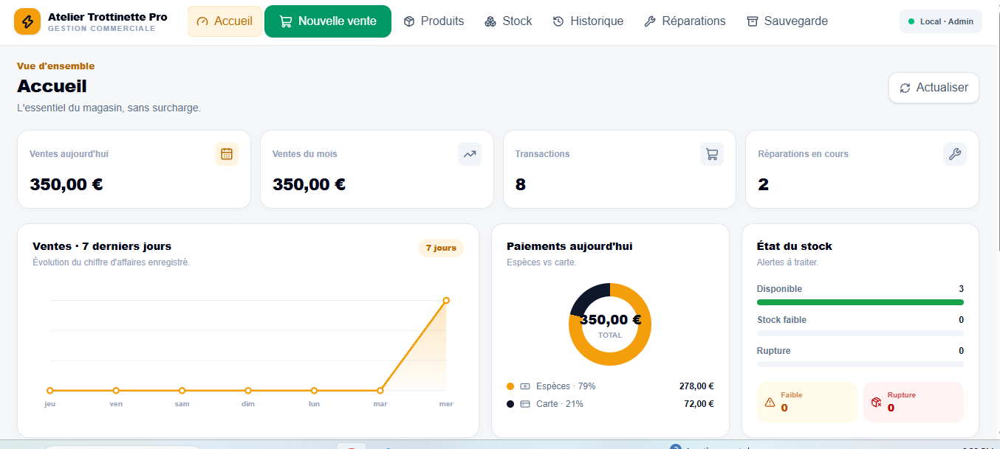
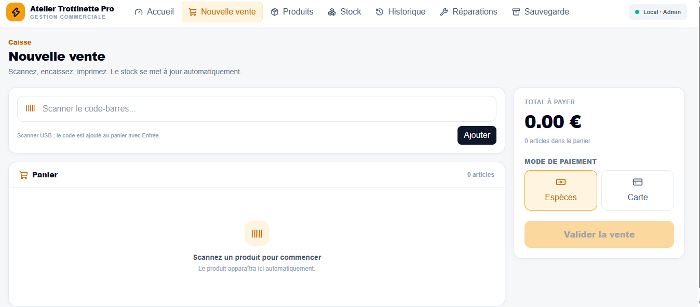
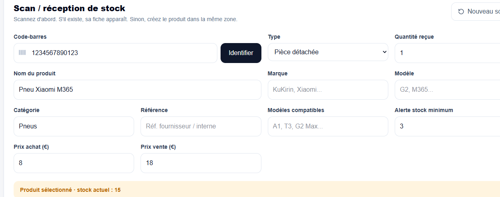
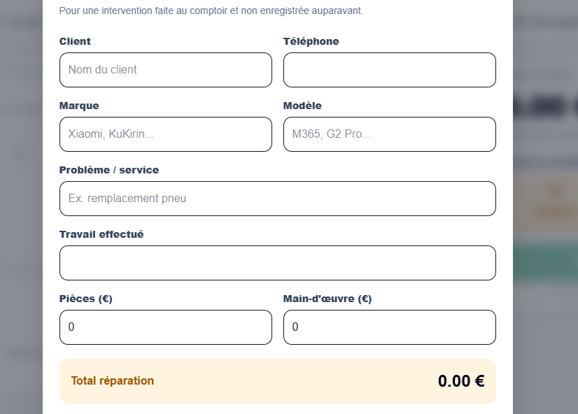

# ATP POS

**Atelier Trottinette Pro — point of sale, inventory & workshop management**

ATP POS is a custom local-first business system built for a scooter shop. It centralizes day-to-day counter operations in one interface: product sales, barcode lookup, stock control, repair follow-up, receipts, reporting and local backups.

> **Project status:** active development / local Windows deployment

## Screenshots

| Dashboard | Point of sale |
| --- | --- |
|  |  |

| Stock management | Repair checkout |
| --- | --- |
|  |  |

## What the system handles

| Area | Capabilities |
| --- | --- |
| **Point of sale** | Barcode lookup, product selection, mixed carts, cash/card payments and receipt printing |
| **Inventory** | Product references, brands, categories, buy/sell prices, quantities and low-stock thresholds |
| **Repairs** | Reception, status tracking, preparation for checkout and payment through the main POS cart |
| **Sales history** | Transaction history, receipt reprint, sale cancellation and product returns |
| **Reporting** | Sales, transactions, payment methods, stock and repair activity |
| **Backups** | Automatic and manual SQLite database backups for local operation |

## Main features

- Barcode-based product lookup and checkout
- Mixed cart for spare parts, scooters, accessories and repairs
- Cash and card payment recording
- Automatic stock deduction after completed sales
- Product catalogue with barcode, reference, brand, category, prices and stock thresholds
- Low-stock and out-of-stock visibility
- Sales history with traceable cancellations and product returns
- Repair workflow from reception to checkout and return
- Ready repairs can be added directly to the main POS cart
- Dashboard and reports for sales, transactions, payments, stock and active repairs
- Printable receipts and receipt reprint
- Automatic and manual SQLite backups
- Local Windows launcher for daily shop use

## Tech stack

- **Frontend:** React 19, TypeScript, Vite, Tailwind CSS
- **Backend:** Node.js, Express, TypeScript
- **Database:** SQLite with better-sqlite3
- **Package manager:** pnpm
- **Runtime:** local Windows PC + browser

## Architecture

```text
Barcode scanner / browser
          |
          v
     React frontend
          |
          v
   Express REST API
          |
          v
    SQLite database
```

The system is designed to run locally on the shop computer. The browser is the user interface, while business data is stored in SQLite rather than browser localStorage.

## Core sales workflow

```text
Scan / select product
        -> cart
        -> cash or card
        -> validate sale
        -> stock updated
        -> transaction saved
        -> receipt printed
```

Repairs are tracked separately during workshop work. Once a repair is marked ready and has a final amount, it can be added to the same checkout cart as physical products. After payment, the repair is marked as returned.

## Development

### Backend

```bash
cd backend
pnpm install
pnpm dev
```

### Frontend

```bash
cd frontend
pnpm install
pnpm dev
```

Frontend development URL: `http://localhost:5173`

Backend API: `http://localhost:3001`

## Windows local use

The repository includes helper scripts for local deployment and daily operation:

- `BUILD_WINDOWS.bat`
- `START_WINDOWS.bat`
- `STOP_WINDOWS.bat`
- `RESTORE_BACKUP.bat`

After a production build, the application can be opened locally without VS Code.

## Data safety

Real shop databases, sales history, backups and customer information are intentionally excluded from this repository through `.gitignore`.

Do **not** commit:

- `data/*.db`
- `backups/`
- `.env` files
- customer or sales exports

Use test/demo data for screenshots and development.

## Project context

Developed by **HUSS TECH** as a custom business system for **Atelier Trottinette Pro**, alongside its commercial website and product catalogue.

**Portfolio:** https://huss-tech.fr  
**Client website:** https://ateliertrottinettepro.fr

---

> This repository documents the software project and its engineering workflow. Any fiscal or cash-register compliance required for production use should be validated separately for the applicable legal context.
